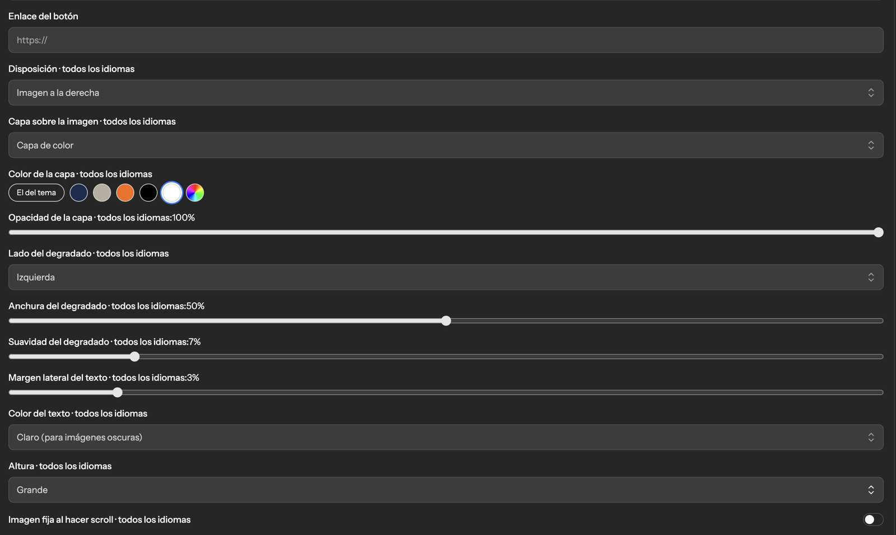
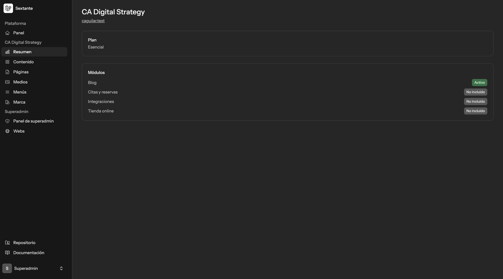
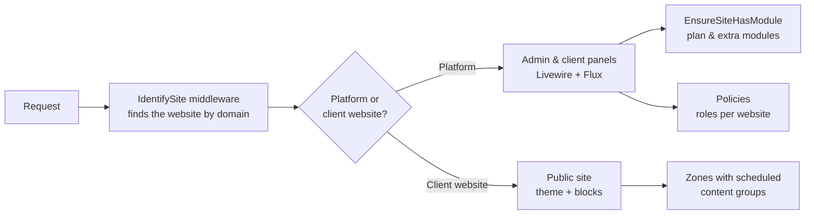
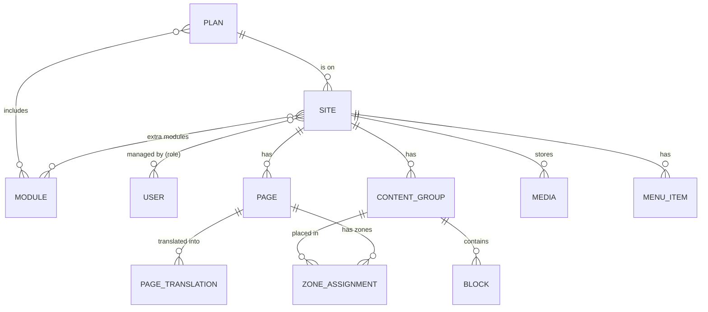

# Sextante

**A multi-site website platform (SaaS) built with Laravel.** One installation serves many websites. Each business gets its own panel to manage pages, design, texts and, later, bookings and orders, with full control over its website and no need to touch code. Features are sold as plans and modules, so each client only pays for what it uses.

> **Status:** in active development since October 2026, about 20 hours a week. The first production website (my own, currently on WordPress) is planned to move to the platform in early 2027.
> The source code is private while the platform is being built. I'm happy to walk through the code in an interview.

## Screenshots

**Public website** rendered from blocks, with the site's own theme, fonts and colours:

**Block editor:** design options of the hero block (layout, colour overlay, gradient, text colour, height). Fields marked *all languages* are shared between translations:

**Website panel:** each website's plan and modules, with the panel menu adapting to the modules that are active:

## Why I'm building it

I wanted my own alternative to WordPress for client websites: a common core that I maintain and host, themes for each brand, and paid modules (appointments, online store, CRM/ERP integrations) that can be switched on for each client. Clients get near-total freedom over their content and design from their panel, without ever needing access to the code.

The content model is based on the e-commerce backoffice I used every day in my previous role as a digital project manager: block types, groups of blocks, and page zones with a calendar for campaigns. I kept what worked well for the people editing the site, and automated the parts we used to do by hand.

## What's built so far

- **Many websites, one platform.** Each request is matched to a website by its domain, so the platform panel and every client website run from the same codebase.
- **Plans and modules.** Each website has a plan (Essential, Professional, Store) that switches features on or off: blog, appointments and bookings, online store and integrations. Extra modules can be added outside the plan, and a middleware protects every module's routes. Prices are stored as integer cents to avoid rounding errors.
- **Roles and permissions.** A superadmin manages websites, plans, extras and users. Each website has its own users with their own roles (administrator with full control, editor), enforced with Laravel Policies.
- **Block-based content editor.** Pages are built from reusable content groups made of blocks (hero, text, text with image, list, call to action), each with its own design options. The hero alone has options for layout, colour overlay, gradient, height and alignment.
- **Scheduled content.** Content groups are placed in page zones with optional start and end dates, so a campaign (a Christmas home page, a seasonal banner) switches on and off by itself. Single zones like the home teaser show one group at a time: if several are active, the one that started most recently wins. The editor shows each assignment as *live now*, *scheduled*, *ended* or *waiting* (active but covered by another one). Dates are entered in local time and stored in UTC.
- **Multilingual websites.** Pages are translated per language, while fields that don't change between languages (images, links, colours) are shared. The admin panel is available in Spanish and English, per user.
- **Media library.** Uploaded images are resized and converted to WebP automatically, and can be reused in any block.
- **Brand and themes.** Each website sets its logo, colours and fonts, and picks a theme for its public pages. Header and footer menus are configurable.
- **Rich text editing.** A visual text editor (TipTap) with the theme's colour palette; the HTML is sanitized on the server before it's saved.
- **Secure accounts.** Login with two-factor authentication and passkeys.

## Tech stack

| Area | Technology |
|---|---|
| Backend | PHP 8.3+, Laravel 13 |
| Frontend | Livewire 4, Flux UI, Tailwind CSS 4, Vite |
| Editor | TipTap |
| Database | PostgreSQL (SQLite for tests) |
| Auth | Laravel Fortify, 2FA, passkeys |
| Images | Intervention Image |
| Quality | Pest (100+ tests), PHPStan / Larastan, Laravel Pint |
| CI | GitHub Actions: lint, static analysis and tests on every push |
| Hosting | My own server (planned) |

## Architecture

### Data model (simplified)

## Design decisions

- **One codebase, website detected by domain.** Instead of one installation per client, a middleware identifies the website on every request. Updates and fixes reach every website at once.
- **Livewire + Flux instead of an admin generator.** I considered Filament, but chose to build both panels by hand with Livewire and Flux, to keep full control over the client experience.
- **Features as modules, not as code branches.** Plans are just sets of modules stored in the database, so a new plan or an extra feature for one client doesn't need new code.
- **Content groups separate from pages.** A group of blocks can be reused on several pages and scheduled with dates, which is what campaigns and seasonal content need.
- **Polymorphic zone assignments.** Zones are attached to pages today, but the same table can attach content to blog categories or products when those modules arrive.
- **Shared vs translated fields.** Only text is translated; images and settings are stored once, so editors don't repeat work for each language.
- **Quality checks from day one.** Every push runs code style, static analysis and the full test suite, so the project stays maintainable as it grows.

## Roadmap

| Phase | Scope | Timeline |
|---|---|---|
| 1 | Core platform: multi-site, content, public sites and SEO, forms and leads, cookie consent, migration of the first website from WordPress (with 301 redirects) | Oct 2026 – Jan 2027 (in progress) |
| 2 | Appointments and bookings module, Stripe subscriptions, client self-onboarding, custom domains with automatic HTTPS, starter templates by industry | Feb – Mar 2027 |
| 3 | REST API, webhooks and a first CRM/ERP connector, built-in analytics and per-site dashboard, CSV/Excel exports | Mar – Apr 2027 |
| 4 | Online store: products, orders, filtered category pages | Apr – Jun 2027 |

Next up in phase 1: SEO (meta tags, Open Graph, sitemap, hreflang), blog, configurable forms with a leads inbox, more block types and drag-and-drop in the editor.

## How I work on it

The project is planned in phases with a task board, and every development step is written up in a development log (23 steps so far): what was built, why, and the Laravel concepts involved. Commits are small and focused, and every push runs the CI checks.

## Contact

[LinkedIn](https://www.linkedin.com/in/carolina-aguilar-guarnido-627201174) · [GitHub](https://github.com/carolaggu97-stack)
